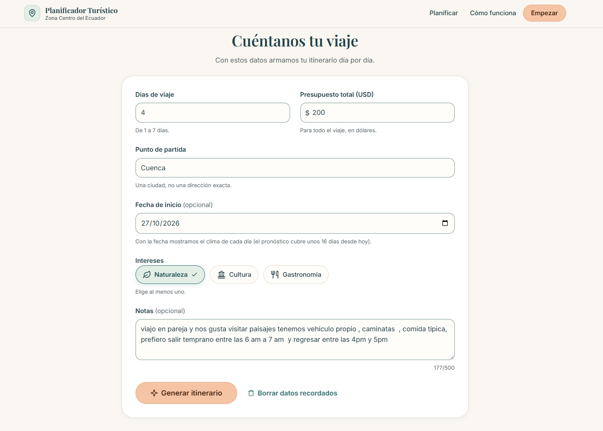
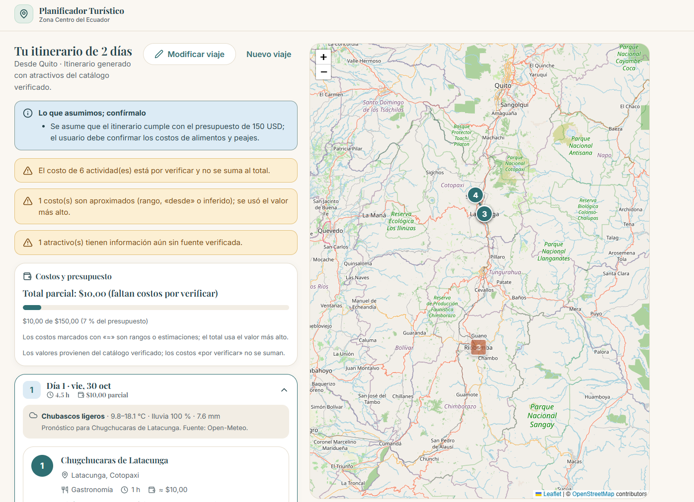

# Planificador Turístico Inteligente de la Zona Centro del Ecuador

Proyecto académico: constructor de itinerarios con mapa que usa **RAG** y un **agente de alcance controlado** sobre un
catálogo verificado de atractivos de **Tungurahua, Chimborazo, Cotopaxi y Bolívar**, con pronóstico del clima de una
API externa. Backend en FastAPI (este repositorio); frontend en Angular (`PlanificadorTuristico.Web`).

## Estado real al 7 de noviembre de 2026 (Entrega 3)

| Punto de la Entrega 3 | Estado | Dónde está |
|---|---|---|
| Conocimiento especializado | Hecho | 139 fichas de atractivos y páginas oficiales y de prensa, con manifiesto trazable: `data/corpus/manifiesto.csv`, `scripts/construir_corpus.py` |
| RAG con citas y silencio | Hecho | `src/services/rag.py`: Chroma + E5, agrupado por atractivo, margen y **piso de similitud** calibrado (`.env`, [docs/07-rag.md](docs/07-rag.md)). Las citas las valida el código |
| Agente de alcance controlado | Hecho | `src/agente.py`: `PERMITIDAS` (4 herramientas), `max_iter` en `config/parametros.yaml`, `REQUIEREN_OK` (envío con confirmación). `POST /agente` y `POST /agente/confirmar/{id}`. ADR en [docs/09-decisiones.md](docs/09-decisiones.md) |
| Herramientas deterministas | Hecho | `src/tools/`: esquema Pydantic, función determinista y prueba por herramienta; parámetros en `config/` |
| Flujo automatizado | Hecho (disparador web) | Regla de alcance en código → RAG → modelo → reglas del código → persona. [docs/10-automatizacion.md](docs/10-automatizacion.md) |
| Calidad del software | Hecho | `pytest -q`: **198 pruebas**, cobertura del 95 % (el build falla por debajo del 85 %). CI en `.github/workflows/ci-cd.yml`: Gitleaks, pruebas e imagen Docker |
| Evaluación | Hecho | `eval/`: 15 preguntas, 15 solicitudes y 10 casos del agente, escritos antes de correr. `python eval/evaluar.py` (modos `rag`, `solicitudes` y `agente`). Resultados con línea base en [evaluacion-entrega3.md](docs/evidencias/semana-3/evaluacion-entrega3.md) |
| Plan de calidad | Hecho | [docs/11-plan-de-calidad.md](docs/11-plan-de-calidad.md) |
| Despliegue | Hecho | Docker + Traefik en VPS; CD solo desde `master`. [docs/08-despliegue-docker.md](docs/08-despliegue-docker.md) |

**Resultados de la evaluación con Groq** (una corrida por caso): RAG con 100 % de acierto y 100 % de silencio correcto,
solicitudes 14/15 (la restante pasa corrida aparte), adversarias rechazadas 4/4, agente 10/10.

### Lo que NO hace todavía

- **No optimiza la ruta** (HU-07): el modelo agrupa por cantón y el orden se muestra tal cual. No hay geocodificación
  del punto de partida.
- **No envía correos de verdad:** `enviar_itinerario` es simulado (queda en `logs/bandeja_salida.jsonl` con el correo
  enmascarado).
- **No hay disparador por mensajería** (WhatsApp o Telegram) como planteó el taller de automatización: el disparador es
  el formulario web.
- **El frontend todavía no usa el agente:** el contrato está listo ([docs/06-guia-frontend.md §7](docs/06-guia-frontend.md)),
  pero falta el panel de conversación y el botón de confirmación.
- **Una sola corrida por caso de evaluación:** la variación del modelo no está medida.
- **La regla de alcance es una lista de patrones:** un destino fuera de la zona que no esté en `config/alcance.yaml`
  pasa al modelo, que es la segunda barrera.
- **Las acciones pendientes del agente viven en memoria:** sirven con un solo proceso de uvicorn.
- **El catálogo no distingue eventos con fecha** (p. ej. la Fiesta de las Flores y de las Frutas, en febrero): `recalcular`
  puede proponer uno fuera de temporada.
- Muchos costos y duraciones del catálogo siguen `POR VERIFICAR`: se excluyen del total y se avisa.

## Estructura

```
.
├── config/
│   ├── parametros.yaml       # jornada, holgura del reemplazo, tope del agente, vencimiento de confirmaciones
│   └── alcance.yaml          # reglas de alcance (reservas, fuera de la zona, médico, inyección)
├── data/
│   ├── catalogo/             # atractivos.csv (139), atractivos_reducido.csv (60, para el prompt)
│   ├── corpus/manifiesto.csv # trazabilidad de cada documento del RAG
│   ├── raw/                  # fichas y páginas descargadas (no versionado)
│   └── vectorstore/          # índice Chroma (no versionado)
├── docs/                     # propuesta, requisitos, arquitectura, RAG, despliegue, ADR, calidad y evidencias
├── eval/                     # conjuntos de evaluación, evaluar.py, línea base y resultados
├── scripts/                  # corpus, ingesta, evaluación del RAG, comparación de prompts, servidor simulado
├── src/
│   ├── main.py               # FastAPI: /health, /itinerario, /itinerario/stream, /agente, /agente/confirmar/{id}
│   ├── agente.py             # agente de alcance controlado: lista cerrada, tope y confirmación
│   ├── alcance.py            # regla de alcance en código, antes del modelo
│   ├── catalogo.py           # carga el catálogo verificado
│   ├── config.py             # lee .env (Groq / simulado)
│   ├── parametros.py         # lee y valida config/parametros.yaml
│   ├── schemas.py            # entradas, salida del modelo y respuestas de la API
│   ├── prompts/              # system_v1…v4.md (itinerario) y agente_v1.md
│   ├── services/
│   │   ├── clima.py          # Open-Meteo con degradación controlada
│   │   ├── indice.py         # fragmentación, embeddings y configuración del RAG
│   │   ├── itinerario.py     # el modelo propone, el código dispone
│   │   ├── llm.py            # ClienteLLM: reintentos, 429, timeout, respaldo, JSON validado, tools, log
│   │   └── rag.py            # recuperación con margen y piso de similitud
│   └── tools/
│       ├── recalcular.py         # reemplaza un atractivo (lluvia, cerrado, preferencia) con reglas fijas
│       ├── buscar_fragmentos.py  # busca en las fuentes con el piso de similitud para preguntas
│       ├── consultar_clima.py    # pronóstico de un día del itinerario
│       └── enviar_itinerario.py  # requiere confirmación del visitante (envío simulado)
├── tests/                    # 198 pruebas, sin red ni clave (dobles del modelo, del RAG y del clima)
├── Dockerfile, docker-compose.yml
└── .github/workflows/        # CI/CD y revisión de secretos
```

## Instalación

Requisitos: Python 3.10 o superior.

```bash
python -m venv .venv
.venv\Scripts\Activate.ps1        # Windows (PowerShell);  en Linux/macOS: source .venv/bin/activate
pip install -r requirements.txt
cp .env.example .env              # en PowerShell: Copy-Item .env.example .env
# Edite .env: GROQ_API_KEY (https://console.groq.com/keys). Nunca suba .env al repositorio.

# Índice del RAG (una vez; sin él la API funciona igual, pero sin citas)
python scripts/construir_corpus.py   # fichas + páginas fuente (con --sin-red, solo fichas)
python scripts/ingestar_rag.py       # fragmenta, calcula embeddings e indexa en data/vectorstore

uvicorn src.main:app --reload        # http://127.0.0.1:8000/docs
```

## Uso

**Itinerario** (`POST /itinerario`, o `/itinerario/stream` con texto en vivo):

```json
{"dias": 2, "presupuesto_usd": 150, "punto_partida": "Ambato", "intereses": ["natural", "gastronómico"],
 "notas": null, "fecha_inicio": "2026-11-20"}
```

El modelo elige los atractivos y escribe los motivos. El código descarta lo que no está en el catálogo, respeta la
jornada de 8 h, calcula los costos (los `POR VERIFICAR` se excluyen y el total se marca parcial), valida las citas,
agrega el clima por día y advierte si se supera el presupuesto. Reservas, pagos, consejo médico, destinos fuera de la
zona e instrucciones dentro de `notas` se rechazan **antes** de llamar al modelo.

**Agente** (`POST /agente`): se envía el itinerario actual con un mensaje, por ejemplo «va a llover el día 1». El
agente consulta el clima, reemplaza lo que es al aire libre con `recalcular` y devuelve el itinerario actualizado, los
cambios, las fuentes consultadas y las advertencias. Si el visitante pide enviarlo a su correo, la respuesta es
`requiere_confirmacion` y nada se envía hasta `POST /agente/confirmar/{id}`. Contrato en
[docs/06-guia-frontend.md §7](docs/06-guia-frontend.md).

## Pruebas y evaluación

```bash
pytest -q                                   # 198 pruebas, sin red ni clave
pytest -q --cov=src                         # cobertura (CI exige 85 %)
python eval/evaluar.py rag                  # sin Groq: acierto y silencio del RAG
python eval/evaluar.py solicitudes --pausa 45
python eval/evaluar.py agente --pausa 40
```

Cada llamada al modelo queda en `logs/llm.jsonl` (tokens y tiempo, sin el texto del usuario) y cada decisión del agente
en `logs/agente.jsonl`.

## Documentación

1. [Propuesta](docs/01-propuesta.md) · [Levantamiento](docs/levantamiento.md)
2. [Requisitos](docs/02-requisitos.md)
3. [Arquitectura](docs/03-arquitectura.md)
4. [Fuentes](docs/04-fuentes.md)
5. [Guía del frontend](docs/06-guia-frontend.md)
6. [RAG](docs/07-rag.md)
7. [Despliegue con Docker](docs/08-despliegue-docker.md)
8. [ADR del agente](docs/09-decisiones.md)
9. [Flujo automatizado](docs/10-automatizacion.md)
10. [Plan de calidad](docs/11-plan-de-calidad.md)
11. Evidencias: [Semana 1](docs/evidencias/semana-1/README.md) · [Semana 2](docs/evidencias/semana-2/README.md) · [Semana 3](docs/evidencias/semana-3/README.md) · [Evaluación de la Entrega 3](docs/evidencias/semana-3/evaluacion-entrega3.md)

| Formulario | Resultado con mapa |
|---|---|
|  |  |

## Aviso

La información turística debe contrastarse con fuentes oficiales. El sistema no realiza reservas ni pagos ni emite
recomendaciones médicas o de seguridad.
