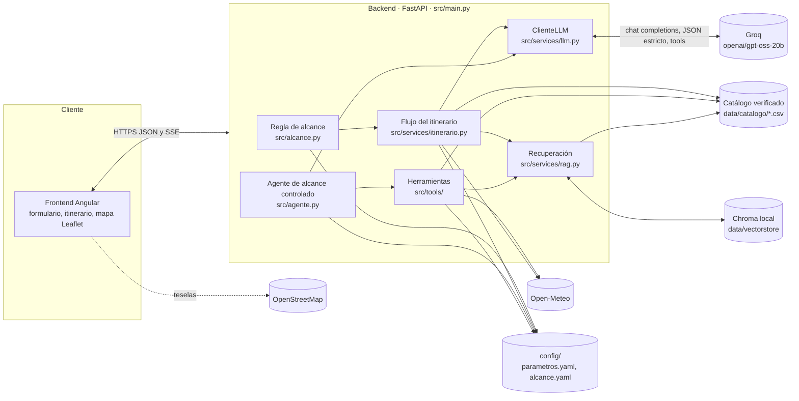
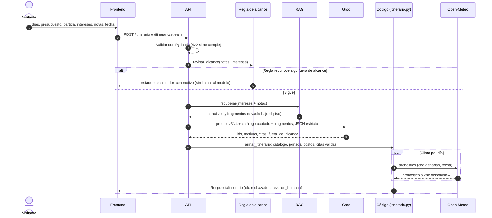
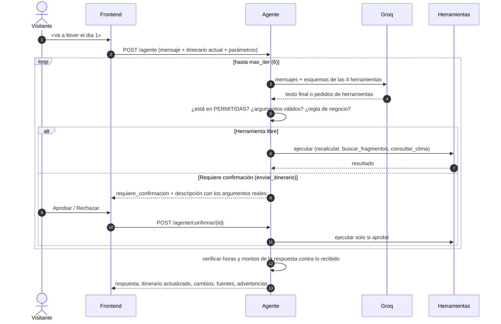

# Arquitectura

**Versión:** 0.4 (Entrega 3, noviembre de 2026) · Describe lo **implementado**. Lo que cambió respecto del diseño de la
Semana 1, y por qué, está en la sección 5.

## 1. Vista general

### Componentes

| Componente | Dónde | Responsabilidad |
|---|---|---|
| API | `src/main.py` | Endpoints, validación de entrada (Pydantic), inyección de dependencias, errores 503 claros |
| Regla de alcance | `src/alcance.py`, `config/alcance.yaml` | Rechaza en código, sin llamar al modelo, reservas y pagos, destinos fuera de la zona, consejo médico e inyección (HU-09) |
| Flujo del itinerario | `src/services/itinerario.py` | El modelo **propone** ids y motivos; el código **dispone**: valida contra el catálogo, reparte la jornada, calcula costos, valida citas y agrega el clima |
| Agente | `src/agente.py` | Conversa sobre un itinerario ya generado con 4 herramientas, lista cerrada, tope de vueltas y confirmación humana ([09-decisiones.md](09-decisiones.md)) |
| Herramientas | `src/tools/` | `recalcular`, `buscar_fragmentos`, `consultar_clima` (libres) y `enviar_itinerario` (con confirmación). Cada una tiene esquema Pydantic y función determinista |
| Recuperación (RAG) | `src/services/rag.py`, `src/services/indice.py` | Embeddings E5 locales, búsqueda en Chroma agrupada por atractivo, margen y piso de similitud ([07-rag.md](07-rag.md)) |
| ClienteLLM | `src/services/llm.py` | Único punto que habla con el proveedor: reintentos, 429, tiempo de espera, respaldo, JSON validado, tools, registro de tokens |
| Clima | `src/services/clima.py` | Open-Meteo por coordenadas y fecha; nunca hace fallar la solicitud |
| Catálogo | `src/catalogo.py`, `data/catalogo/` | Fuente de verdad: 139 atractivos (130 con ubicación). El prompt del itinerario usa un subconjunto equilibrado de 60 para ahorrar tokens; el agente usa los 130 |
| Parámetros | `src/parametros.py`, `config/parametros.yaml` | Jornada, holgura del reemplazo, tope del agente, vencimiento de confirmaciones, historial |

### Principios

1. **El catálogo manda:** ningún atractivo fuera del catálogo llega al visitante. El modelo elige por id y el código pone nombre, costo, duración y coordenadas.
2. **El modelo propone, el código dispone:** costos, horas, reemplazos y citas los calcula o valida el código.
3. **Regla → IA → persona:** lo que una regla reconoce no necesita al modelo; lo dudoso o riesgoso pasa a una persona (`revision_humana`, confirmación).
4. **Lista cerrada y confirmación:** el agente solo tiene 4 herramientas. La única que sale del sistema espera la aprobación del visitante.
5. **Degradación segura:** sin RAG, sin clima o sin modelo, la API responde con un aviso claro y nunca con un error crudo.
6. **Todo lo que entra es dato, no orden:** el texto del visitante, los fragmentos web y los resultados de herramientas.

## 2. Secuencia: generar un itinerario (flujo fijo)

## 3. Secuencia: conversar con el agente

## 4. Endpoints

| Método y ruta | Uso |
|---|---|
| `GET /health` | Estado de la API |
| `POST /itinerario` | Itinerario completo en una respuesta |
| `POST /itinerario/stream` | El mismo itinerario con texto en vivo (SSE) |
| `POST /agente` | Conversación sobre un itinerario generado |
| `POST /agente/confirmar/{id}` | Aprobar o rechazar la acción pendiente |

Contrato detallado para el frontend: [06-guia-frontend.md](06-guia-frontend.md). Despliegue: [08-despliegue-docker.md](08-despliegue-docker.md).

## 5. Cambios respecto del diseño de la Semana 1

| Diseño de la Semana 1 | Implementado | Por qué |
|---|---|---|
| El agente orquesta todo, incluida la generación del itinerario | La generación es un **flujo fijo**; el agente trabaja sobre el itinerario ya generado | Los pasos de generar son siempre los mismos: un flujo es más barato, predecible y auditable. El agente solo donde el camino no se puede escribir de antemano (lluvia, cierre, preguntas). Ver [10-automatizacion.md](10-automatizacion.md) |
| Guardrails como componente aparte | Validación Pydantic, regla de alcance, validación contra catálogo y de citas, verificación de datos del agente | Cada control vive junto a lo que protege |
| Optimizador de ruta (HU-07) | **No implementado**; el modelo agrupa por cantón y el orden se muestra tal cual | Prioridad menor (Should); pendiente |
| Geocodificación del punto de partida | **No implementada**; el punto de partida es texto que el modelo considera | Sin servicio de geocodificación por ahora |
| `POST /itinerario/recalcular` | `POST /agente` con la herramienta `recalcular` | El cambio de un atractivo se decide en código con reglas fijas; no rehace el viaje |
| Herramientas de solo lectura | 3 de solo lectura + `enviar_itinerario` con confirmación humana | La Entrega 3 pide una acción con confirmación; el envío es simulado |

## 6. Decisiones tomadas

| Tema | Decisión |
|---|---|
| Modelo generativo | Groq `openai/gpt-oss-20b` (API compatible con OpenAI); servidor simulado local para practicar errores |
| Base vectorial | Chroma local persistente: unos 140 atractivos y pocos cientos de fragmentos no justifican un servicio aparte |
| Embeddings | `intfloat/multilingual-e5-small` local (no se comparó con `bge-m3`: pendiente) |
| Clima | Open-Meteo (sin clave, uso no comercial) |
| Mapas | Leaflet + teselas de OpenStreetMap en el frontend |
| Frontend | Angular (repositorio `PlanificadorTuristico.Web`) |
| Despliegue | Docker + Traefik en un VPS; CI/CD con GitHub Actions (CD solo desde `master`) |
