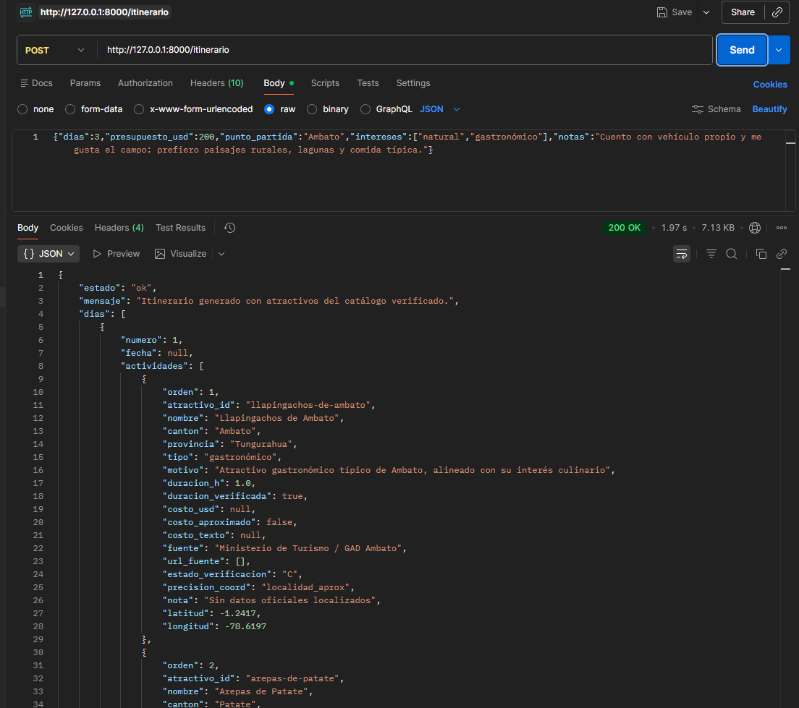
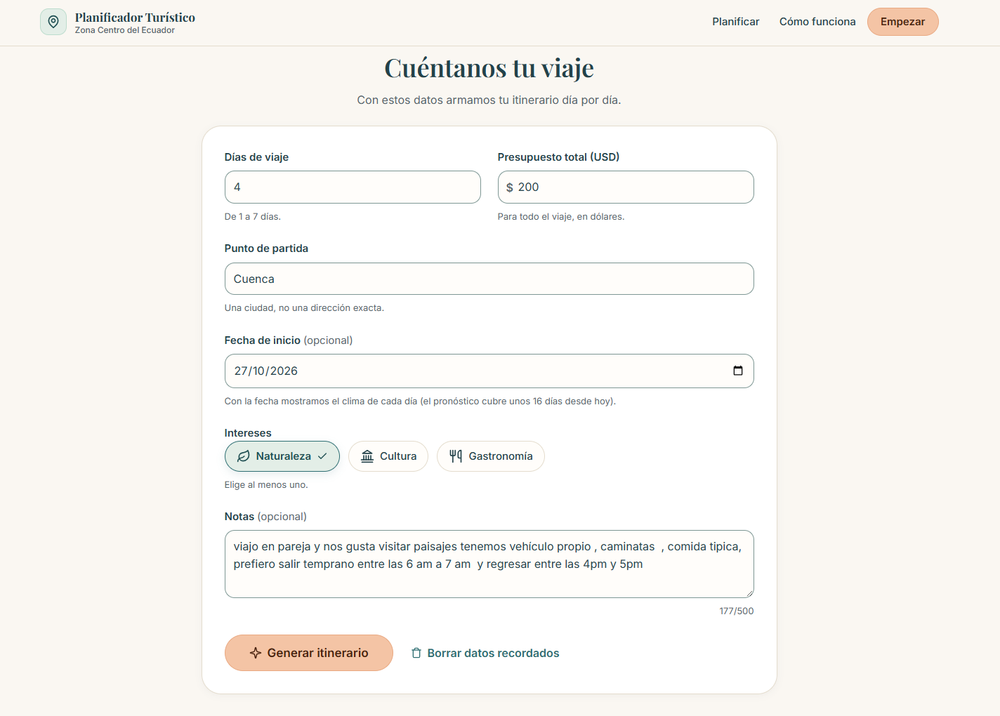
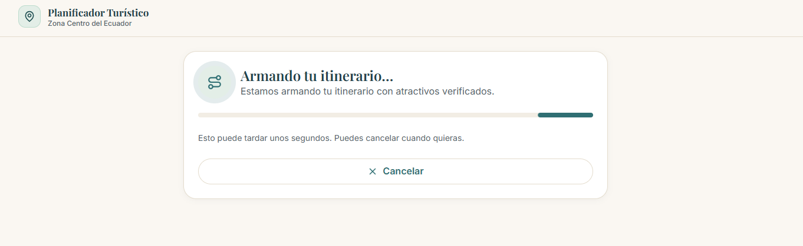
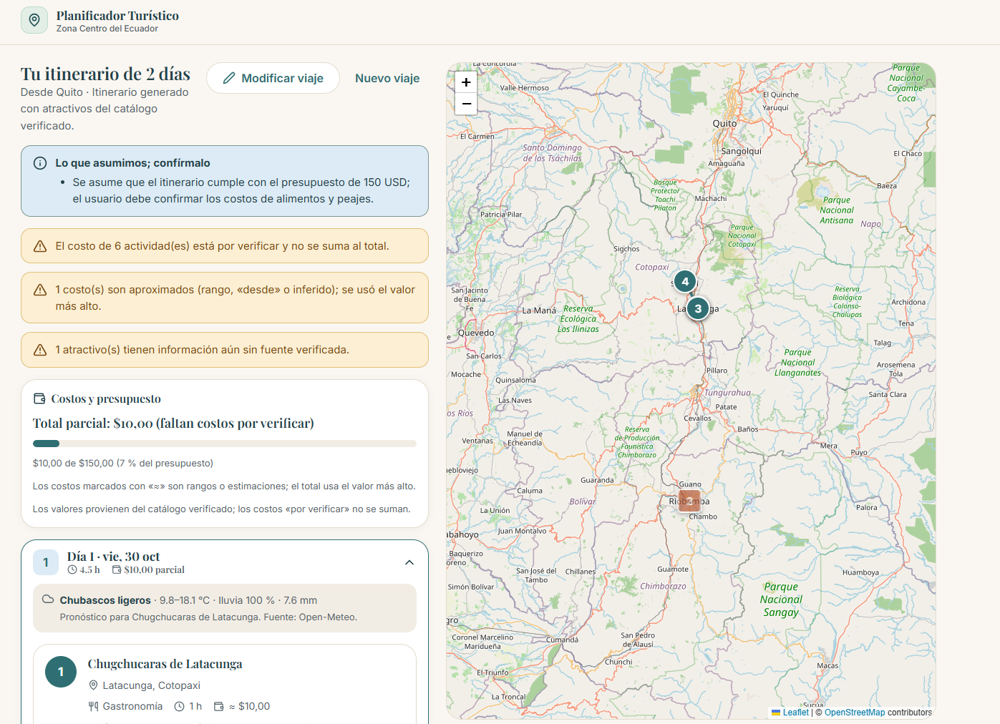
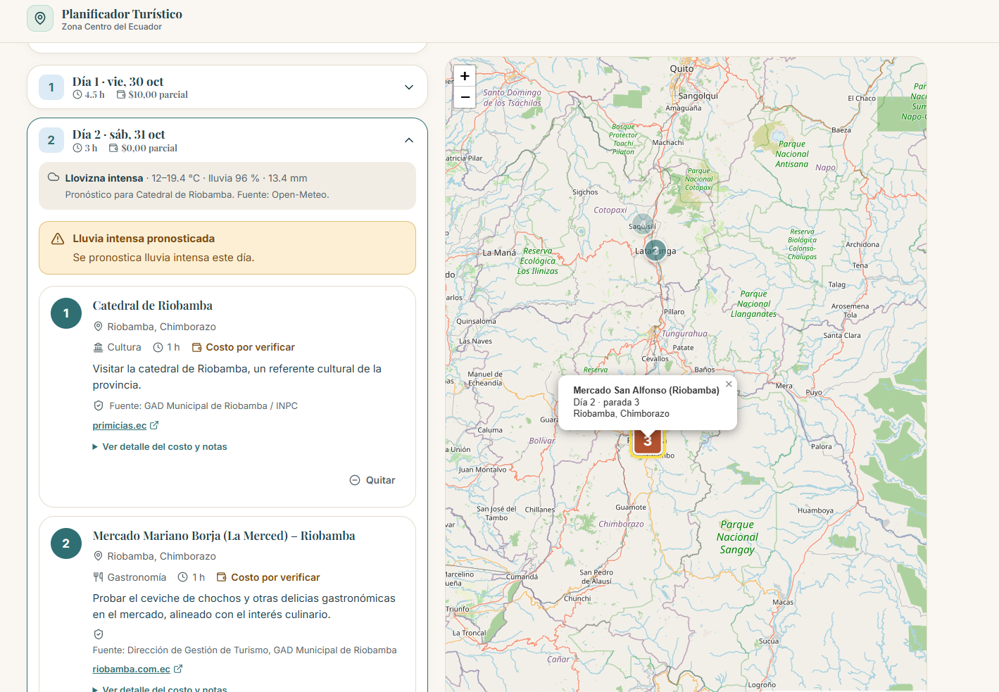

# Evidencias · Semana 2

Funcionamiento de la API (FastAPI + Groq + Open-Meteo) integrada con el frontend (Angular). Las capturas muestran el flujo completo: petición, generación, itinerario sobre el mapa y clima por día.

## 1. Capturas

| # | Descripción | Archivo |
|---|---|---|
| 1 | `POST /itinerario` probado en Postman: `200 OK`, `estado: "ok"`, actividades del catálogo con fuente, estado de verificación y coordenadas | `captura-01-postman-itinerario.png` |
| 2 | Formulario del frontend: días, presupuesto, punto de partida, fecha de inicio, intereses y notas | `captura-02-formulario-frontend.png` |
| 3 | Pantalla de generación en curso (progreso mientras la API responde, con opción de cancelar) | `captura-03-generando.png` |
| 4 | Resultado: supuestos y avisos, costos y presupuesto, itinerario por día y mapa con marcadores numerados | `captura-04-resultado-mapa.png` |
| 5 | Detalle del día 2: clima de Open-Meteo, alerta por lluvia intensa y marcador seleccionado en el mapa | `captura-05-dia-clima-marcador.png` |

### 1. API en Postman

Petición:

```json
{"dias":3,"presupuesto_usd":200,"punto_partida":"Ambato","intereses":["natural","gastronómico"],"notas":"Cuento con vehículo propio y me gusta el campo: prefiero paisajes rurales, lagunas y comida típica."}
```

Respuesta: `200 OK` en 1,97 s (7,13 KB) con `estado: "ok"` y el mensaje «Itinerario generado con atractivos del catálogo verificado». Cada actividad trae `atractivo_id`, `motivo`, `duracion_h`, `costo_usd` (o `null` si es por verificar), `fuente`, `estado_verificacion`, `precision_coord`, `nota`, `latitud` y `longitud`.



### 2. Formulario

Datos ingresados: 4 días, USD 200, partida Cuenca, inicio 27/10/2026, interés «Naturaleza» y notas en texto libre (177/500 caracteres). La fecha de inicio es opcional y habilita el clima por día.



### 3. Generación en curso



### 4. Itinerario y mapa

Muestra lo que la API devuelve y el frontend dibuja sin alterarlo:

- **Supuestos** que el usuario debe confirmar (presupuesto, alimentos y peajes).
- **Avisos**: costos por verificar que no se suman al total, costos aproximados (se usa el valor más alto) y atractivos sin fuente verificada.
- **Costos y presupuesto**: total parcial con barra de avance respecto al presupuesto.
- **Itinerario por día** con duración y costo parcial, y **mapa** (Leaflet + OpenStreetMap) con marcadores numerados por parada.



### 5. Clima y marcador

Cada día muestra el pronóstico (temperatura, probabilidad de lluvia y precipitación, fuente Open-Meteo) y una alerta cuando se pronostica lluvia intensa. Al seleccionar una actividad, el mapa resalta su marcador y muestra el día, la parada y el cantón.



## 2. Verificación de requisitos con las capturas

| Requisito / HU | Evidencia |
|---|---|
| HU-01 Formulario de planificación | Captura 2 |
| HU-02 Itinerario día por día | Capturas 1, 4 |
| HU-03 Mapa interactivo | Capturas 4, 5 |
| HU-04 Fuente por atractivo | Capturas 1, 5 |
| HU-05 Costos y presupuesto (total parcial) | Captura 4 |
| HU-06 Clima y alerta por lluvia | Captura 5 |
| HU-09 Avisos y supuestos | Captura 4 |

## 3. Observaciones

- Las capturas 4 y 5 corresponden a ejecuciones distintas a las de las capturas 1 y 2 (distintos parámetros); lo que se demuestra es el flujo, no una única corrida.
- Muchos costos siguen `POR VERIFICAR` y no se suman al total, por eso el total es parcial.
- La ruta optimizada (trazado entre paradas) aún no existe; el mapa solo muestra marcadores en el orden recibido.
